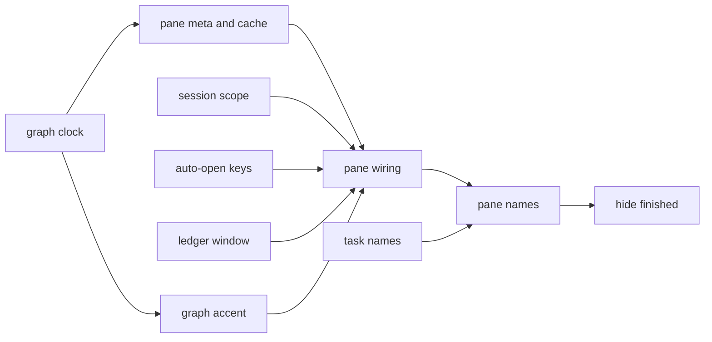

# Agent map blink: prototype plan

**Goal:** the desktop agent map stops blinking (SMIL clock inside the SVG, graph cache with a 1-minute resync), shows one superlite session (named, coloured, following `session use`), opens by itself once per run (`autoOpen` option), and its ledger scrolls in its own box.
**Architecture:** pure helpers in their own modules (`hooks/graph.ts` clock and accent, `hooks/model.ts` registry and session scope, `hooks/autoopen.ts` run keys, `hooks/ledger.tsx` ledger window and box); `hooks/register.tsx` wires them: refresh, pane render, graph cache, open, scroll.
**Tech stack:** TypeScript + JSX Claude Code mod (`claude-code` API 2.1.309), tests through `claude-code/testing`.
**Spec:** docs/plans/2026-11-01-agent-map-blink.feature.md (main checkout), Acceptance checks Parts 1-4.
**Detail:** contracts
**Target-min:** 14
**Ignore:** .claude-plugin/types/

Global constraints:
- Test command: `"$HOME/Library/Application Support/Claude/claude-code/2.1.309/5af865b9901c/claude.app/Contents/MacOS/claude" plugin test .` from the worktree root (now 37 tests, 35 pass; T2's two failing tests are its own to fix). No package.json, no node_modules: do not add any.
- API types: `/private/tmp/claude-501/bundled-skills/2.1.309/16bca0a132d97d6964d9e22d51bb2f55/plugin-authoring/types/claude-code.d.ts` (grep it; `ui.scroll`, `SiteScroll`, `UiScrollInput`, `Register` options). `register(on, options)` receives `userConfig` values; tests pass them with `test(name, { options }, body)`.
- FROZEN: `graphSvg(main, nodes, maxWidth) -> { source, width, height }`, `treeOrder`, `mergeCards(live, files, usage)` (new args optional only), pane id `claude-agent-map`, title `Agent map`, command `claude-agent-map [project dir]`, tool `open_agent_map`, the `Svg` keeps `isInteractive`.
- The text tree rows and the terminal surface keep `metaOf(c)` = `tier · elapsed · tokens` and the 1-second tick.
- Decided choices: resync 60 s; scope = the superlite session this Claude session works in, all its Claude sessions' agents; `<dir>` argument = that folder's superlite session; `autoOpen` default `agents`; ledger box 10 rows with buttons + wheel at pane end.

## Task graph

Ruling: T1 is done (checkpoint f75a701); it stays in the graph so T6's edge is real.
Ruling: T2 resumes as dispatched (frozen; its 2 failing tests: the 1 s tick only runs once `session.start` ran); T7 is the follow-up wiring task on the same files after T2 - frozen blocks stay byte-identical - cost if wrong: T7 is the long pole, about 6 minutes.

## Package: graph

**Probe entry:** call=hooks/graph.graphSvg

### T1 graph clock · Complexity 4 (O-1) · Est. context 30k
**Owns:** hooks/graph.ts, tests/model.test.ts
**Components:** 1
**LOC owned:** 110
**Tests:** fast
**Kind:** design
**Model:** sonnet
**Est. time:** 2.5 min (1 component, about 110 LOC, fast tests)
**Consumes:** none
**Produces:** graph.clockBand(ms: number) -> 'short' | 'mid' | 'long'
e.g. clockBand(65000) -> 'short'
e.g. clockBand(600000) -> 'mid'
e.g. clockBand(3600000) -> 'long'
**Produces:** graph.liveClock(id: string, elapsedMs: number, x: number, y: number) -> string
e.g. liveClock('a1', 65000, 0, 0) -> a `<g data-clock="a1">` string containing `begin="-65s"`, `dur="10s"`, `dur="60s"`, `dur="600s"`, `repeatCount="indefinite"`, no `dur="3600s"`
e.g. liveClock('a1', 3725000, 0, 0) -> contains `begin="-3725s"` and `dur="36000s"`
**Produces:** GraphNode.clockMs?: number (running node's elapsed ms at build; absent for done/aborted)
**Review Focus:** `liveClock id with quotes and spaces`: liveClock('a "b" c', 1000, 0, 0) gives clip-path ids of only [A-Za-z0-9_-] and a valid attribute; `clock with 0 ms`: liveClock('a', 0, 0, 0) contains `begin="-0s"` or `begin="0s"`; `done node no clock`: graphSvg with a done node without clockMs has no `data-clock`.
**Test code (verbatim):** named tests, in `describe('graph clock')` in tests/model.test.ts:
- `clockBand bands`: the three e.g. lines above, plus clockBand(599999) -> 'short', clockBand(3599999) -> 'mid'.
- `liveClock short`: liveClock('a1', 65000, 0, 0) matches the first e.g. line.
- `liveClock long`: liveClock('a1', 3725000, 0, 0) matches the second e.g. line.
- `graphSvg draws a clock for a running node`: graphSvg(main, [{ id: 'a1', title: 'T', meta: 'sonnet', tasks: '', status: 'running', clockMs: 65000 }]) source contains `data-clock="a1"` and `begin="-65s"`; the same node with status 'done' and no clockMs has no `data-clock`.
- `graphSvg is stable for the same input`: two calls with the same args give identical `source`.
- The three Review Focus cases.
**Steps:** 1 failing tests, 2 run: FAIL, 3 implement, 4 run: PASS
**Notes:** odometer: one clipped digit strip per place (glyphs stacked vertically, monospace `ui-monospace, Menlo, monospace`, 11px), each strip a discrete `animateTransform` translate with all strips sharing `begin="-<whole seconds>s"`: seconds ones dur 10s n 10, seconds tens 60s n 6, minute ones 600s n 10, minute tens 3600s n 6 (band 'mid' and 'long'), hour ones 36000s n 10 (band 'long'). Digit at time t = floor(((E + t) mod dur) / (dur / n)). Band 'short' draws `m:ss`, 'mid' `mm:ss`, 'long' `h:mm:ss`. `box()` draws the node meta as today and, when `clockMs` is set, the clock right-aligned on the meta line inside the box (shorten the meta clip by the clock width). The `<title>` tooltip never contains the clock.

### T6 graph accent · Complexity 2 (O-1) · Est. context 14k
**Owns:** hooks/graph.ts, tests/model.test.ts
**Components:** 1
**LOC owned:** 30
**Tests:** fast
**Kind:** mechanical
**Model:** haiku
**Est. time:** 1.5 min (1 component, about 30 LOC, fast tests)
**Consumes:** none
**Produces:** GraphMain.accent?: string (a `#rrggbb` colour; absent keeps today's main box)
e.g. graphSvg({ title: 'agent-map-blink', meta: 'm', status: 'running', accent: '#8250df' }, [], 420).source -> contains `data-accent="#8250df"` on the main box's `<rect` and a 4px left bar `fill="#8250df"`
e.g. graphSvg({ title: 'Main session', meta: 'm', status: 'running' }, [], 420).source -> contains no `data-accent`
**Review Focus:** `accent is escaped`: accent `'"><x'` never breaks out of the attribute (use `esc`; only `#[0-9a-fA-F]{6}` is drawn, anything else is ignored).
**Test code (verbatim):** in a new `describe('graph accent')` in tests/model.test.ts: the two e.g. lines, the Review Focus case, and `same input same source` (two calls with the accent are identical).
**Steps:** 1 failing tests, 2 run: FAIL, 3 implement, 4 run: PASS
**Notes:** add `accent?: string` to `GraphMain`; in the main node's drawing, when `accent` matches `/^#[0-9a-fA-F]{6}$/`, add `data-accent` to its `<rect` and draw a `<rect x+1.5 y+9 width=4 height=h-18 rx=2 fill=accent/>` bar like the node role bar. The main box's stroke stays the status colour. Do not touch the clock code.

## Package: model

**Probe entry:** call=hooks/model.pickSession

### T3 session scope · Complexity 4 (O-1) · Est. context 30k
**Owns:** hooks/model.ts, tests/session.test.ts
**Components:** 1
**LOC owned:** 120
**Tests:** fast
**Kind:** design
**Model:** sonnet
**Est. time:** 3 min (1 component, about 120 LOC, fast tests)
**Consumes:** none
**Produces:** model.SessionRow = { slug: string; branch: string; worktree: string; status: string; createdAt?: number }
**Produces:** model.Registry = { active?: string; host?: string; sessions: SessionRow[] }
**Produces:** model.parseRegistry(text: string) -> Registry | undefined
e.g. parseRegistry('{"v":2,"active":"a","host_worktree":"/p","sessions":[{"slug":"a","branch":"superlite/sessions/a","worktree":"/p","status":"active","created_at":5}]}') -> { active: 'a', host: '/p', sessions: [{ slug: 'a', branch: 'superlite/sessions/a', worktree: '/p', status: 'active', createdAt: 5 }] }
e.g. parseRegistry('nope') -> undefined
**Produces:** model.registryPaths(dir: string) -> string[] (candidate `sessions.json` paths for a `.superlite` dir, nearest first, each ancestor folder's `/.superlite/sessions.json`)
e.g. registryPaths('/p/.superlite/worktrees/sessions/b/.superlite') -> ['/p/.superlite/worktrees/sessions/b/.superlite/sessions.json', '/p/.superlite/worktrees/sessions/.superlite/sessions.json', '/p/.superlite/worktrees/.superlite/sessions.json', '/p/.superlite/sessions.json', '/.superlite/sessions.json'] (stop at root; dedupe)
e.g. registryPaths('C:/p/.superlite') -> ['C:/p/.superlite/sessions.json', 'C:/.superlite/sessions.json']
**Produces:** model.pickSession(reg: Registry, root: string) -> SessionRow | undefined (`root` = the project folder the `.superlite` dir sits in; the row whose `worktree` equals root, slashes normalised, trailing slash ignored; else, when root equals `reg.host`, the `active` row; else undefined)
e.g. pickSession(reg with host '/p', active 'a', rows a@/p and b@/p/.superlite/worktrees/sessions/b, '/p/.superlite/worktrees/sessions/b') -> row b
e.g. pickSession(same, '/p') -> row a
e.g. pickSession(same, '/q') -> undefined
**Produces:** model.slugColour(slug: string) -> string (stable `#rrggbb` from an 8-colour palette by a string hash)
e.g. slugColour('a') === slugColour('a'); slugColour('agent-map-blink') !== slugColour('other-slug') for these two
**Produces:** model.mergeCards(live, files, usage, opts?: { since?: number }) -> Card[] (file launch/stop rows with `t < since` are dropped unless the agent is in `live`; no opts = today)
e.g. mergeCards({}, files with launch r1 t=1000 and launch r2 t=9000, {}, { since: 5000 }) -> one card, r2
**Review Focus:** `windows paths`: pickSession with worktree 'C:\\p' and root 'C:/p/' matches; `registry missing fields`: a sessions entry without slug is skipped, a non-array `sessions` gives `sessions: []`; `live agent older than since`: kept.
**Test code (verbatim):** `describe('session scope')` in tests/session.test.ts: every e.g. line above and the three Review Focus cases; plus `mergeCards without opts is unchanged` (same result as the 3-arg call).
**Steps:** 1 failing tests, 2 run: FAIL, 3 implement, 4 run: PASS
**Notes:** the registry's own key is `created_at` (epoch ms) and `host_worktree`. Pure functions only; no `$`, no fs. Keep every existing export and its behaviour. Import style and `Obj` helpers as in the file.

## Package: autoopen

**Probe entry:** call=hooks/autoopen.spawnRunKey

### T4 auto-open keys · Complexity 3 (O-1) · Est. context 22k
**Owns:** hooks/autoopen.ts, tests/autoopen.test.ts, .claude-plugin/plugin.json
**Components:** 1
**LOC owned:** 70
**Tests:** fast
**Kind:** design
**Model:** sonnet
**Est. time:** 2 min (1 component, about 70 LOC, fast tests)
**Consumes:** none
**Produces:** autoopen.AutoOpen = 'agents' | 'superlite' | 'off'
**Produces:** autoopen.autoOpenMode(options: unknown) -> AutoOpen (reads `options.autoOpen`; anything else -> 'agents')
e.g. autoOpenMode({ autoOpen: 'off' }) -> 'off'; autoOpenMode(undefined) -> 'agents'; autoOpenMode({ autoOpen: 'x' }) -> 'agents'
**Produces:** autoopen.spawnRunKey(mode: AutoOpen, s: { type?: string; at: number; wasIdle: boolean; slug?: string; current?: string }) -> string | undefined (the run key this spawn belongs to; `current` is the key of the run in progress, if any)
e.g. spawnRunKey('agents', { type: 'Explore', at: 10, wasIdle: true }) -> 'agents:10'
e.g. spawnRunKey('agents', { type: 'Explore', at: 20, wasIdle: false, current: 'agents:10' }) -> 'agents:10'
e.g. spawnRunKey('superlite', { type: 'Explore', at: 10, wasIdle: true }) -> undefined
e.g. spawnRunKey('superlite', { type: 'superlite:implementer', at: 10, wasIdle: true, slug: 'a' }) -> 'a:10'
e.g. spawnRunKey('agents', { type: 'superlite:implementer', at: 30, wasIdle: false, slug: 'a', current: 'a:10' }) -> 'a:10'
e.g. spawnRunKey('off', { type: 'superlite:implementer', at: 10, wasIdle: true, slug: 'a' }) -> undefined
**Produces:** autoopen.fileRunKey(mode: AutoOpen, f: { slug?: string; poolMtime?: number; firstLaunchT?: number; featureBuilding?: boolean; startedT?: number }) -> string | undefined (`slug` required; run start = poolMtime ?? firstLaunchT ?? (featureBuilding ? startedT : undefined); 'off' -> undefined)
e.g. fileRunKey('agents', { slug: 'a', poolMtime: 500 }) -> 'a:500'
e.g. fileRunKey('superlite', { slug: 'a', firstLaunchT: 700 }) -> 'a:700'
e.g. fileRunKey('agents', { poolMtime: 500 }) -> undefined
**Produces:** autoopen.shouldOpen(key: string | undefined, opened: string | undefined) -> boolean (key defined and !== opened)
**Produces:** plugin.json `userConfig.autoOpen`: `{ "type": "string", "title": "Open the agent map by itself", "description": "agents: any subagent run; superlite: superlite runs only; off: never", "options": ["agents", "superlite", "off"], "default": "agents" }`
**Review Focus:** `superlite slug missing`: spawnRunKey('superlite', { type: 'superlite:x', at: 1, wasIdle: true }) -> 'superlite:1' (no slug -> literal 'superlite'); `idle after a superlite run`: wasIdle true always starts a new key even with `current` set.
**Test code (verbatim):** `describe('auto-open keys')` in tests/autoopen.test.ts: every e.g. line, the two Review Focus cases, and shouldOpen('a:1', 'a:1') -> false, shouldOpen('a:2', 'a:1') -> true, shouldOpen(undefined, 'a') -> false.
**Steps:** 1 failing tests, 2 run: FAIL, 3 implement, 4 run: PASS
**Notes:** superlite agent = `type` starting `superlite:`. A spawn with wasIdle false and a `current` key keeps it; with wasIdle false and no current, starts a key at `at`. Pure, no `$`. Check the manifest still loads: `claude plugin validate .` after editing plugin.json (keep name, version, description, author, license, types).

## Package: ledger

**Probe entry:** call=hooks/ledger.ledgerWindow

### T5 ledger window · Complexity 3 (O-1) · Est. context 24k
**Owns:** hooks/ledger.tsx, tests/ledger.test.ts
**Components:** 1
**LOC owned:** 80
**Tests:** fast
**Kind:** design
**Model:** sonnet
**Est. time:** 2.5 min (1 component, about 80 LOC, fast tests)
**Consumes:** none
**Produces:** ledger.LEDGER_ROWS = 10
**Produces:** ledger.ledgerWindow(lines: string[], offset: number | null, rows?: number) -> { shown: string[]; start: number; older: number; newer: number } (`offset` null = pinned to the end; else the first line shown, clamped to [0, max(0, len-rows)])
e.g. ledgerWindow(40 lines L0..L39, null) -> { shown: L30..L39, start: 30, older: 30, newer: 0 }
e.g. ledgerWindow(40 lines, 5) -> { shown: L5..L14, start: 5, older: 5, newer: 25 }
e.g. ledgerWindow(40 lines, 99) -> start 30; ledgerWindow(40 lines, -3) -> start 0
e.g. ledgerWindow(['a','b'], null) -> { shown: ['a','b'], start: 0, older: 0, newer: 0 }
**Produces:** ledger.ledgerMove(lines: number, offset: number | null, by: number, rows?: number) -> number | null (new offset after scrolling `by` lines, negative = older; reaching the end returns null so it pins again)
e.g. ledgerMove(40, null, -3) -> 27; ledgerMove(40, 27, 3) -> null; ledgerMove(40, 0, -5) -> 0; ledgerMove(5, null, -3) -> null (fits: nothing to scroll)
**Produces:** ledger.LedgerBox(p: { el: { Box: any; Text: any; Button: any }; id: string; title: string; lines: string[]; offset: number | null; onMove: (offset: number | null) => unknown }) -> JSX tree or null (null when no lines): title row, `▲ older (n)` Button key `ledger-older-<id>` (only when older > 0), a `Box` `borderStyle="round"` `overflow="hidden"` key `ledger-<id>` holding the shown lines, `▼ newer (n)` Button key `ledger-newer-<id>` and `End` Button key `ledger-end-<id>` (only when newer > 0). Older/newer move by LEDGER_ROWS.
**Review Focus:** `empty ledger`: LedgerBox with lines [] returns null; `rows 0 or negative`: ledgerWindow(lines, null, 0) treats rows as 1.
**Test code (verbatim):** `describe('ledger window')` in tests/ledger.test.ts: every ledgerWindow / ledgerMove e.g. line and the Review Focus cases (pure; LedgerBox is tested by T2 through the pane).
**Steps:** 1 failing tests, 2 run: FAIL, 3 implement, 4 run: PASS
**Notes:** JSX compiles against the global `h` as in register.tsx; `LedgerBox` takes the elements from its caller (`$.ui.resolve(e)`), so it never imports the engine. Do not edit register.tsx.

## Package: pane

**Probe entry:** call=hooks/register.register

### T2 pane meta and cache · Complexity 4 (O-1) · Est. context 36k
**Owns:** hooks/register.tsx, tests/pane.test.tsx, README.md
**Components:** 1
**LOC owned:** 90
**Tests:** fast
**Kind:** design
**Model:** sonnet
**Est. time:** 2.5 min (1 component, about 90 LOC, fast tests)
**Consumes:** graph.clockBand(ms: number) -> 'short' | 'mid' | 'long' (T1) · graph.liveClock(id: string, elapsedMs: number, x: number, y: number) -> string (T1) · GraphNode.clockMs?: number (T1)
**Produces:** none
**Review Focus:** `details and back re-anchors`: running a1, desktop mount, advance 5000, press card-a1, press back: SVG contains `begin="-5s"`; `reopen re-anchors`: after advance 7000, running the command `claude-agent-map` again gives an SVG with `begin="-7s"`.
**Test code (verbatim):** named tests, in `describe('graph stability')` in tests/pane.test.tsx; `world()` returns the `mock.clock(on, { now: 1_000_000 })` handle:
- `the graph SVG stays the same while only the clock moves`: `$.classic.SubagentStart({ agent_id: 'a1', agent_type: 'superlite:implementer' })`, mount desktop Pane, read svgSource and `card-a1` text; `await clock.advance(1000)`; svgSource is `toBe` the first; `card-a1` text differs.
- `a running agent's graph holds a live clock`: same setup; svgSource contains `data-clock="a1"` and `repeatCount="indefinite"`.
- `a status change redraws the graph`: same setup; `$.turn.complete({ agentId: 'a1', turnId: 't1', answer: 'done' } as never)`; svgSource differs and has no `data-clock="a1"`.
- the two Review Focus cases.
- Existing `metrics rows fill the card` desktop branch: svg contains `sonnet` and `1m 0s` is allowed only as the done node's fixed time; svg does not contain `1.5k tok`. The terminal branch stays `sonnet · 1m 0s · 1.5k tok · T3 T4`.
**Steps:** 1 failing tests, 2 run: FAIL, 3 implement, 4 run: PASS
**Notes:** graph node meta: running -> tier (`c.tier ?? '?'`) with `clockMs: elapsedMs(c, at)`; done/aborted -> `tier · fmtDuration(elapsed)`, no clockMs. Cache: module-level `let lastGraph: { key: string; g: { source: string; width: number; height: number } } | undefined`; key = JSON of `{ main, width, nodes }` with each node's `clockMs` replaced by `clockBand(clockMs)`; equal key reuses `lastGraph.g`. Set `lastGraph = undefined` in `show()` and whenever the card-details branch renders. README: the graph shows tier and live time per agent; the list under it shows time and tokens.

### T7 pane wiring · Complexity 7 (O-1) · Est. context 60k
**Owns:** hooks/register.tsx, types/index.d.ts, tests/pane.test.tsx, README.md
**Components:** 4
**LOC owned:** 260
**Tests:** fast
**Kind:** design
**Model:** sonnet
**Est. time:** 6 min (4 components, about 260 LOC, fast tests)
**Consumes:** pane meta and graph cache (T2) · GraphMain.accent (T6) · model.parseRegistry, registryPaths, pickSession, slugColour, mergeCards opts.since (T3) · autoopen.autoOpenMode, spawnRunKey, fileRunKey, shouldOpen (T4) · ledger.LEDGER_ROWS, ledgerWindow, ledgerMove, LedgerBox (T5)
**Produces:** none
**Review Focus:** `details and back re-anchors`: running a1, desktop mount, advance 5000, press card-a1, press back: SVG contains `begin="-5s"`; `reopen re-anchors`: after advance 7000, the command gives `begin="-7s"`; `closed pane stays closed`: after the pane opened for run key K and is closed (`$.ui.close` or the mock's close), another spawn in K does not open it.
**Test code (verbatim):** in tests/pane.test.tsx (after T2):
- `describe('graph stability')`: T2's tests stay green; plus `tokens wait for the resync` (desktop: transcript usage grows within 60 s -> SVG identical, list shows the new count; after `advance(60_000)` the SVG shows the new count) and `the resync re-anchors` (advance 61_000: source changed, contains `begin="-61s"`; then advance 1000 more: identical).
- `an agent change redraws`: a second SubagentStart, or a pool.json tier/tasks change, gives a different SVG at once.
- `describe('superlite session')`: files `/p/.superlite/sessions.json` (active a, rows a@/p, b@/p/.superlite/worktrees/sessions/b, created_at 5000) + `/p/.superlite/metrics.jsonl` (launch r0 t=1000, launch r1 t=9000), map opened on `/p`: header text contains `a · superlite/sessions/a`, only r1 shows; SVG has `data-accent`. Then the registry changes to active b with b's files at `/p/.superlite/worktrees/sessions/b/.superlite/` and the host files swapped: after `advance(3000)` header says `b`, the accent differs; the cwd-is-b case: dir `/p/.superlite/worktrees/sessions/b` shows b. No registry: header contains `no superlite session`.
- `per-session folder`: after `claude-agent-map /other`, a new `session.start` (fresh `$.state`, same `$.store`) uses the working directory, not `/other`.
- `describe('auto-open')`: with the pane not open, `classic.SubagentStart` `Explore` opens it (`autoOpen` default); a second spawn while busy does not open it again; after all stop and a new spawn, it opens again; with `{ options: { autoOpen: 'superlite' } }` Explore does not, `superlite:implementer` does; with `'off'` nothing does, the command still does; `pool.json` appearing for the session's slug opens it on the next refresh; the Review Focus closed-pane case.
- `describe('ledger box')` on terminal and desktop: progress.md with 40 lines: `ledger-main` shows the last 10, `ledger-older-main` text `▲ older (30)`; press it: shown lines move 10 older, `ledger-newer-main` appears; press `ledger-end-main`: back at the end. A new line while pinned shows at once; while scrolled up the window stays and newer counts up. `ui.scroll` on the pane with `by: -3` and `scroll.offset` at the end (offset + bodyRows >= content) moves the ledger 3 older; with offset 0 on a tall tree it moves the pane (hook returns next). Ledger moves leave the SVG source unchanged. A card's details show its ledger lines in a `ledger-<id>` box.
- Change T2's `metrics rows fill the card` desktop branch (user's later choice, tokens back in the graph): SVG contains `sonnet · 1m 0s` and `1.5k tok`; terminal stays `sonnet · 1m 0s · 1.5k tok · T3 T4`.
**Steps:** 1 failing tests, 2 run: FAIL, 3 implement, 4 run: PASS
**Notes:**
- Graph meta: running -> `tier · tokens` + `clockMs: elapsedMs`; done/aborted -> `tier · fixed elapsed · tokens`, no clockMs. Cache key = JSON of `{ main, width, epoch, nodes }` with tokens removed from each node's meta and `clockMs` replaced by `clockBand`; `epoch = anyRunning ? Math.floor(at / 60_000) : 0`. Tokens are drawn but not keyed: when the key holds, reuse `lastGraph`. Clear `lastGraph` in `show()`, on the details branch, and on a slug change.
- Session scope in `refresh()`: try `registryPaths(dir)` with `$.fs.read` until one parses; `root` = `dir` without its trailing `/.superlite`; `pickSession(reg, root)`; when a row is found, read the run files from `<row.worktree>/.superlite` and pass `{ since: row.createdAt }` to `mergeCards`. Keep the picked slug, branch and `slugColour(slug)` in the `files` value (add optional `session?: { slug: string; branch: string; accent: string }` to `Superlite` in types/index.d.ts). When the slug differs from the last refresh: clear `usage`, `readAt`, `lastGraph`, the ledger offsets.
- Header: with a session `slug · branch · N agents · M active`; without `no superlite session · N agents · M active` (today's `· dir` suffix kept after it when hasMetrics). Main node: `title` = slug when there is a session, `accent` = its colour.
- Folder per Claude session: `$.state` atom `dir` (declare in types) replaces `$.store` `dir`; drop the `$.store.get/set('dir')` calls.
- Auto-open: `register(on, options)`; `mode = autoOpenMode(options)`. Keep `opened` (last opened key) and `runKey` (current) atoms in `$.state` (declare them). In `markStarted` (spawn and SubagentStart), `wasIdle` = no live agent active before this one; `key = spawnRunKey(...)`; if `shouldOpen(key, opened)`: set opened = key, `openPane`. In `refresh()`: `fileRunKey(mode, { slug, poolMtime (fs.stat of pool.json), firstLaunchT (min launch t >= since), featureBuilding (feature.json status === 'building'), startedT (feature.json started) })`, same rule. Never open from inside `ui.render`.
- Ledger: `ledgerOffsets` atom `Record<string, number | null>` (declare it), key `main` or the card id; `LedgerBox` with `el` from `$.ui.resolve(e)`, onMove writes the offset. Replace `f.ledger.slice(-8)` and the details `slice(-12)`. `on('ui.scroll', { requestId: PANE }, ...)`: if the pane window is at its end and the main ledger has lines that way (`ledgerMove` gives a different offset), update the offset and return `{}`; else `next(e)`.
- README: graph shows tier, live time and tokens (refreshed each minute); the map shows one superlite session named in the header and follows `session use`; it opens by itself once per run (`autoOpen`: agents | superlite | off); the ledger scrolls in its own box.

## Package: tasks

**Probe entry:** call=hooks/tasks.parseTaskNames

### T8 task names · Complexity 3 (O-1) · Est. context 22k
**Owns:** hooks/tasks.ts, tests/tasks.test.ts
**Components:** 1
**LOC owned:** 70
**Tests:** fast
**Kind:** design
**Model:** sonnet
**Est. time:** 2 min (1 component, about 70 LOC, fast tests)
**Consumes:** none
**Produces:** tasks.planPathFrom(texts: { checkpoints?: string; feature?: string; orchestrator?: string }) -> string | undefined (the plan path, relative to the run root, from the first file that names one: checkpoints.json `plan`, then feature.json `plan`, then orchestrator.json `review_path`; bad JSON skipped)
e.g. planPathFrom({ checkpoints: '{"plan":"docs/plans/x.proto.md"}', orchestrator: '{"review_path":"docs/plans/x.feature.md"}' }) -> 'docs/plans/x.proto.md'
e.g. planPathFrom({ checkpoints: 'nope', feature: '{"plan":"docs/plans/x.feature.md"}' }) -> 'docs/plans/x.feature.md'
e.g. planPathFrom({}) -> undefined
**Produces:** tasks.parseTaskNames(planText: string) -> Record<string, string> (each `### T<n> <name> · ...` heading; the name runs to the first ` · `, trimmed; a heading without ` · ` takes the rest of the line)
e.g. parseTaskNames('### T3 session scope · Complexity 4 (O-1)\n### T10 x · y') -> { T3: 'session scope', T10: 'x' }
e.g. parseTaskNames('# Feature plan\n## Goal') -> {}
**Produces:** tasks.taskLabel(id: string, names: Record<string, string>) -> string
e.g. taskLabel('T3', { T3: 'session scope' }) -> 'T3 · session scope'; taskLabel('T9', {}) -> 'T9'
**Produces:** tasks.agentTitle(a: { type?: string; description?: string; current?: string; tasks: string[]; doneTasks: string[] }, names: Record<string, string>) -> string (superlite agent = type starting `superlite:`: the first id of `current` (comma batch) as taskLabel, plus ` +N` for the rest; no current: the last of `tasks` as taskLabel plus ` ✓`; no tasks at all, or not superlite: description || type || '')
e.g. agentTitle({ type: 'superlite:implementer', description: 'Implementer for T3', current: 'T7', tasks: ['T3', 'T7'], doneTasks: ['T3'] }, { T7: 'pane wiring' }) -> 'T7 · pane wiring'
e.g. agentTitle({ type: 'superlite:implementer', current: 'T3,T5,T4', tasks: [], doneTasks: [] }, { T3: 'session scope' }) -> 'T3 · session scope +2'
e.g. agentTitle({ type: 'superlite:implementer', description: 'd', tasks: ['T3', 'T7'], doneTasks: ['T3', 'T7'] }, { T7: 'pane wiring' }) -> 'T7 · pane wiring ✓'
e.g. agentTitle({ type: 'Explore', description: 'list hooks', current: 'T7', tasks: ['T7'], doneTasks: [] }, {}) -> 'list hooks'
**Review Focus:** `heading noise`: `### T3: x · y` and `#### T3 x · y` are not task headings (exactly `### T<digits> `); `current with spaces`: ' T7 , T8' -> 'T7 · ... +1'.
**Test code (verbatim):** `describe('task names')` in tests/tasks.test.ts: every e.g. line and both Review Focus cases.
**Steps:** 1 failing tests, 2 run: FAIL, 3 implement, 4 run: PASS
**Notes:** pure, no `$`, no fs. Import nothing from register.tsx.

## Package: pane names

**Probe entry:** call=hooks/register.register

### T9 pane names · Complexity 4 (O-1) · Est. context 40k
**Owns:** hooks/register.tsx, types/index.d.ts, tests/pane.test.tsx, README.md
**Components:** 1
**LOC owned:** 80
**Tests:** fast
**Kind:** design
**Model:** sonnet
**Est. time:** 3 min (1 component, about 80 LOC, fast tests)
**Consumes:** pane wiring (T7) · tasks.planPathFrom, parseTaskNames, taskLabel, agentTitle (T8)
**Produces:** none
**Review Focus:** `names only rebuild on change`: a refresh with the same plan mtime does not re-read the plan and leaves the SVG source identical; `no plan`: no checkpoints.json/feature.json/orchestrator.json file -> ids alone, no error.
**Test code (verbatim):** `describe('task names')` in tests/pane.test.tsx, on terminal and desktop where it applies:
- run root `/p` (registry as in the `superlite session` tests) with `/p/.superlite/checkpoints.json` = `{"plan":"docs/plans/x.proto.md"}` and `/p/docs/plans/x.proto.md` holding `### T3 session scope · Complexity 4` and `### T7 pane wiring · Complexity 7`; pool.json agent r1 tasks T3 T4, current T7, type superlite:implementer, launch desc `Implementer for T3`: the card row shows `T7 · pane wiring` as its title and `T3 · session scope` among its tasks; the details show `T3 · session scope`; the desktop SVG contains `T7 · pane wiring` and its `<title>` holds `T3 · session scope`.
- pool.json current moves to T3 (file content changes): the title and the SVG change on the next refresh.
- an idle r1 (no current) is titled `T4 ✓` when T4 has no name; an `Explore` live agent keeps its description.
- the two Review Focus cases.
**Steps:** 1 failing tests, 2 run: FAIL, 3 implement, 4 run: PASS
**Notes:** in `refresh()`, after the session pick: read checkpoints.json, feature.json, orchestrator.json from the run's `.superlite/` (missing is fine), `planPathFrom`, resolve against the run root (the folder holding that `.superlite`), `$.fs.stat` it and re-read only when the mtime moved (module cache like `readAt`); keep `taskNames?: Record<string, string>` in the `files` value (add it to `Superlite` in types/index.d.ts). Card title in the list, the details heading and the graph node `title`: `agentTitle({ type, description, current: files.pool[id]?.current, tasks, doneTasks }, names)`. Task chips: `taskLabel` per id (keep the ✓ for done). Details: a `Tasks` row with the full labels. Graph `tasks` string uses the labels; graph.ts clips it as today and its `<title>` already shows the full string. Names change only with the plan or pool, which already counts as an agent change in the cache key, so add nothing to the key beyond the title/tasks strings it already holds.

## Package: hide finished

**Probe entry:** call=hooks/filter.visibleCards

### T10 hide finished · Complexity 4 (O-1) · Est. context 40k
**Owns:** hooks/filter.ts, tests/filter.test.ts, hooks/register.tsx, types/index.d.ts, tests/pane.test.tsx, README.md
**Components:** 2
**LOC owned:** 90
**Tests:** fast
**Kind:** design
**Model:** sonnet
**Est. time:** 3 min (2 components, about 90 LOC, fast tests)
**Consumes:** pane names (T9)
**Produces:** filter.visibleCards(cards: Card[], hideDone: boolean) -> { shown: Card[]; hidden: number } (hideDone false: all, hidden 0; true: running cards plus every ancestor (by `parent`) of a running card; hidden = cards.length - shown.length; order kept)
e.g. visibleCards([a done, b running parent a, c done], true) -> { shown: [a, b], hidden: 1 }
e.g. visibleCards([a done, c done], true) -> { shown: [], hidden: 2 }
e.g. visibleCards(any, false) -> { shown: all, hidden: 0 }
**Review Focus:** `parent cycle`: a parent loop (a->b->a) does not hang; `missing parent`: a parent id not in cards is ignored.
**Test code (verbatim):** `describe('visible cards')` in tests/filter.test.ts: the e.g. lines and both Review Focus cases. `describe('hide finished')` in tests/pane.test.tsx, terminal and desktop: 3 done + 1 running -> only the running card key shows and Button key `toggle-finished` text `Show finished (3)`; press it -> all 4 and `Hide finished`; a done parent of a running child stays while hiding; all done -> text `No running agents` and `Show finished (n)`; the choice survives a new `session.start` (same `$.store`), default on with an empty store; a press changes the SVG source, no press and no change keeps it identical.
**Steps:** 1 failing tests, 2 run: FAIL, 3 implement, 4 run: PASS
**Notes:** `hideDone` lives in `$.store` key `hideDone` (default true), mirrored into an atom for drawing (declare it in types/index.d.ts). Apply `visibleCards` before building the tree rows and graph nodes; header counts use all cards. Add `hideDone` to the graph cache key. The toggle is a plain `Button` key `toggle-finished` in the header row. README: one line on the toggle.

## Review Focus

- graph (library): encoding (accent into SVG attributes), state (deterministic output). Cases on T6.
- model (library): paths (Windows and POSIX), parsing (bad registry). Cases on T3.
- autoopen (library): state (run keys across idle). Cases on T4.
- ledger (library): bounds (clamps). Cases on T5.
- tasks (library): parsing (headings, batches). Cases on T8.
- pane (UI via its tree): state (cache staleness, re-anchoring; slug switch reset, once-per-run open, scroll hand-off). Cases on T2 and T7.

## Self-review

Parts 1-4 covered (T1/T2/T6, T3, T4, T5) and wired by T7; Consumes match Produces; shared files only along edges (T1->T6, T2->T7).
Ruling: sequential [chain-d759] - T1, T6, T7 are done and checkpointed; only T8 -> T9 remains, and T9 wires T8 into the register.tsx T7 left - cost if wrong: none, the chain is already built
Ruling: sequential [chain-7159] - T1, T6, T7, T9 are done and checkpointed; T10 edits register.tsx after T9 - cost if wrong: none
